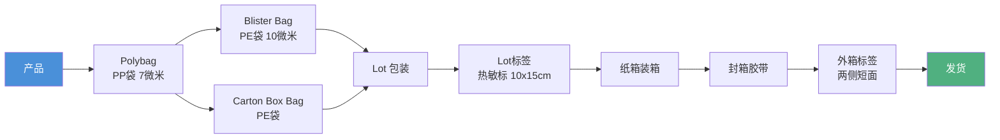

# 纸箱包装标准

本标准（LC.LUK.ST.001）规定了 LC Waikiki 品牌产品从内包装到外箱的全链条包装要求，由 **Mağazacılık Süreç İyileştirme（零售流程改善）** 部门制定（Rev.1, 2021年6月1日）[^1]。

---

## 包装流程总览

---

## 内包装标准

### 包装材料规格

| 包装类型 | 材质 | 厚度 | 注意事项 |
|---------|------|------|---------|
| Polybag（产品袋） | PP（聚丙烯） | 7微米 | 尺寸按产品类型选择 |
| Blister Bag（混合袋） | PE（聚乙烯） | 双层10微米，公差±1微米 | 用于已独立包装的混搭产品 |
| Carton Box Bag（箱袋） | PE（聚乙烯） | — | 用于未混搭的同款产品 |

> ⚠️ **禁止含有 BHT（丁基羟基甲苯）** — PE 和 PP 基料袋均不得含有 BHT[^1]

### Polybag 安全警告

- Polybag 背面（与胶带同侧）必须印有 **安全警告**[^1]

### Lot（批次）包装

- 同一 Lot 的产品应整齐叠放
- Lot 袋（PE）口部用透明胶带封口：
  - 垂直方向：袋边缘两条（4.5cm宽）
  - 水平方向：一条
  - 标签不得贴在未贴胶带的一侧[^1]

| 项目 | 规格 |
|------|------|
| Lot 标签尺寸 | 高10cm × 宽15cm |
| 标签类型 | 热敏标签（Thermal Label） |
| 标签条码内容 | 订单号 + 特殊代码 + 尺码分布 + Lot 号 |
| 封箱胶带宽度 | 4.5cm |

---

## 纸箱标准

### 纸箱材质

| 参数 | 要求 |
|------|------|
| 材质构成 | K/F/F/F/K（牛皮纸/瓦楞纸/瓦楞纸/瓦楞纸/牛皮纸） |
| 克重 | 125 g/m² |
| 类型 | C+B 双瓦楞 |
| 成型方式 | 接缝粘合（不得钉合） |

### 纸箱尺寸

| 纸箱类型 | 尺寸（宽×长×高） |
|---------|----------------|
| 未混装纸箱 | 58 × 38 × 20 cm（标准） |
| 不可折叠产品（外套/夹克等） | 按 Table.2 标准执行 |

> - 纸箱尺寸为 **外到外（out-to-out）** 测量
> - 未混装纸箱若使用非58×38×20尺寸，**不予接受**[^1]

### 重量限制

| 项目 | 限值 |
|------|------|
| 满载纸箱重量 | **≤ 20 kg** |
| 超重处理 | **绝对不接受** |

### 存储要求

- 相对湿度：**50% ~ 70%**
- 瓦楞纸不得直接印刷
- 成品纸箱不得随意滚扔
- 瓦楞纸不得直接放在地面，不得水平堆叠[^1]

---

## MFC 框（MFC Frame）

纸箱两侧长面的右下角必须印制 **70×100 mm** 的黑色线框：

| 参数 | 数值 |
|------|------|
| 水平偏移 | 距底部30mm |
| 垂直偏移 | 距右侧50mm |
| 框架尺寸 | 70mm（高）× 100mm（宽） |

---

## 外箱标签

| 项目 | 要求 |
|------|------|
| 标签位置 | 纸箱 **两个短面** 的正中间 |
| 标签尺寸 | 高10cm × 宽15cm |
| 标签类型 | **非热敏**（普通标签） |
| 质量要求 | 条码扫描器可读取，不褪色、不磨损、不可复印 |

---

## 封箱胶带

- 纸箱的接缝需用胶带密封
- 封口胶带应符合相应的标准要求

---

## 价格标签要求

箱内所有产品必须挂有 **价格标签（Price Hangtag）**：
- 价格标签的详细信息必须可见
- 如有附加标签，应叠放在价格标签下方
- 价格标签上的 **条码 ID 必须清晰可见**[^1]

---

## 条码标准

- 使用 **EAN13** 编码系统（12位数据 + 1位校验码）
- 禁止使用其他编码
- 产品价格标签、内部条码标签、Lot 标签和纸箱标签的信息必须 **一致**

---

## 参考

[^1]: LC.LUK.ST.001_EN_1 CARTON BOX PACKAGING AND LABELLING STANDARD_.pdf, p.3-14
