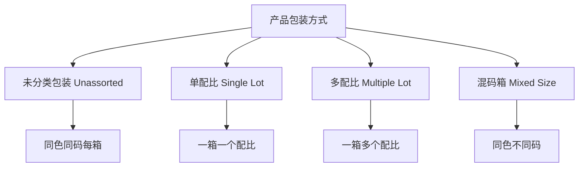

## 概述

**LC.LUK.ST.001**（Rev. No: 1，2021年6月1日）是 LC Waikiki 的纸箱包装与标签标准，规定了从产品包装到运输纸箱的全流程技术要求。[^1]

## 关键定义

| 术语 | 说明 |
|------|------|
| **Polybag (PP)** | 用于单件产品包装的塑料袋，7微米聚丙烯 |
| **Blister Bag (PE)** | 用于将已单独包装的多种产品打包在一起的袋子，双层10微米聚乙烯 |
| **Carton Box Bag (PE)** | 放置已装袋但未分类产品的袋子 |
| **Unassorted Quantity** | 每种颜色每个尺码各一件 |
| **Assortment** | 产品的尺码分布（如 S/1, M/2, L/2, XL/1） |
| **Lot** | 已包装的一个配比组 |
| **EAN13** | 12位数字+1位校验码的条码标准 |

## 纸箱规格

### 纸箱质量要求

| 参数 | 要求 |
|------|------|
| 纸板材质 | K/F/F/F/K（Kraft牛皮纸和Fluting瓦楞纸） |
| 克重 | 125 g/m² |
| 类型 | C+B 双层瓦楞 |
| 最大毛重 | **20 kg**（超重一律拒收） |
| 接合方式 | 粘合（非钉合） |
| 存储湿度 | 相对湿度 50%-70% |

### 纸箱尺寸

| 类型 | 尺寸（宽×长×高） |
|------|-----------------|
| 未分类混合箱 | 58 × 38 × 20 cm |
| 其他品类 | 按产品类型查表选择 |

### MFC 标签框要求

纸箱两个长侧面的右下角必须有 70×100mm 的黑色描边框，框距水平边 30mm，距垂直边 50mm。

## 包装方式

## 标签系统

| 标签类型 | 位置 | 尺寸 |
|---------|------|------|
| **Lot Label（配比标签）** | 箱内配比袋上 | 高10cm × 宽15cm |
| **Carton Box Label（纸箱标签）** | 纸箱两端短侧面中央 | 高10cm × 宽15cm |
| **内条码标签** | 产品价格吊牌上 | EAN13 标准 |

### 标签一致性要求

> 产品价格吊牌、产品内部条码标签、配比标签和纸箱标签上的条码信息必须完全一致。

## 包装关键规则

1. 箱内产品必须分层整齐叠放
2. 配比袋口用 4.5cm 宽透明胶带垂直封两道 + 水平封一道
3. 配比标签不得贴在没有胶带的一侧
4. 所有产品必须有价格吊牌，条码必须清晰可见
5. 箱内不得留有空隙
6. 多配比款式，每个配比高度不超过 14cm（金属检测桥高度）
7. 聚丙烯（PP）和聚乙烯（PE）袋不得含有 BHT（丁基羟基甲苯）

[^1]: LC.LUK.ST.001_EN_1 CARTON BOX PACKAGING AND LABELLING STANDARD_.pdf