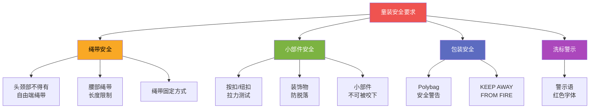

# 儿童安全规范

LC Waikiki 外衣产品标准（ST 257）中专设 **"儿童安全实施"（Childrens' Safety Implementations）** 章节，规定了童装产品的安全要求[^1]。

---

## 安全规范概览

---

## 主要安全要求

### 1. 绳带与拉绳安全

- 头颈部区域不得有自由端的绳带
- 腰部及下摆的绳带长度须在安全范围内
- 绳带须固定，防止意外拉出

### 2. 小部件安全

- 按扣、纽扣、装饰物需通过 **拉力测试**
- 确保儿童无法轻易咬下或扯落小部件
- 防止小零件脱落导致儿童误吞

### 3. 包装安全

- Polybag（塑料袋）背面须印有 **安全警告**
- 包装袋不得过薄，防止儿童窒息风险

### 4. 洗标警示

- "KEEP AWAY FROM FIRE"（远离火源）警告以 **红色 Arial 6pt** 字体印刷
- 出现在所有产品的洗标上[^2]

---

## 相关标准

| 标准 | 相关内容 |
|------|---------|
| ST 257 | 外衣产品儿童安全实施章节 |
| TL.232 | 洗标警示语规范 |
| 包装标准 | Polybag 安全警告 |

---

## 参考

[^1]: Outerwear Apparal Standards.pdf, p.39-47
[^2]: Preparation and Contents of Product Care Labels.pdf, p.2-3
