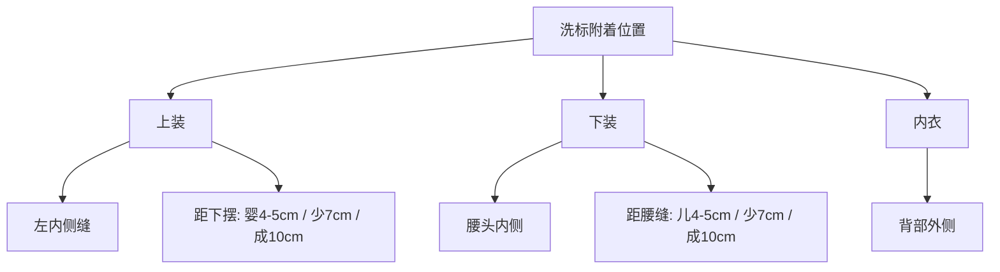

## 概述

LC Waikiki 针对不同面料类型分别制定了标签附着标准：**ST 204（梭织品）** 和 **ST 206（针织品）**。此外还有**产品护理标签制作标准**，规范护理标签的内容与格式。[^1][^2][^3]

## 品牌标签附着方式

### 四种基本附着方式

| 方式 | 示意图 | 适用场景 |
|------|-------|---------|
| **侧折式** (Folded at Side) | 标签对称置于后中两侧，与领缝缝合 | 带领/罗纹领/包边领款式 |
| **底折式** (Bottom Folded) | 标签对称置于后中两侧，底部折叠与领缝缝合 | 带领/拷克缝/包边款式 |
| **蝴蝶式** (Butterfly) | 标签对称置于后中两侧，两侧缝份与领缝缝合 | 带领/拷克缝/包边款式 |
| **旗帜式** (Flag Label) | 折叠线为标签中线，缝份按位置调整 | 装饰性标签 |

## 不同款式的位置要求

### 针织品（ST 206）

| 款式 | 品牌标签位置 | 缝合方式 |
|------|------------|---------|
| 带领款式 | 后中两侧，内领缝处 | 两针水平线，与衣身同色 |
| 罗纹领（拷克缝） | 后中两侧，内拷克缝处 | 两针水平线，与衣身同色 |
| 内领包边 | 后中两侧，内包边处 | 两针水平线，与包边同色 |
| 后领半月片 | 后中两侧，距领缝 2-3cm | 两侧缝合，与衣身同色 |
| 裤子 | 后中两侧，内拷克缝处 | 两针水平线，与衣身同色 |

### 梭织品（ST 204）

| 品类 | 品牌标签位置 |
|------|------------|
| 男裤（带logo内腰） | 左前腰缝，距侧缝 6cm |
| 男女裤 | 内腰后中，四周缝合不外露 |
| 男童衬衫 | 内后过肩，距领缝 2.5cm |
| 可反穿夹克/外套 | 右口袋开口内侧向内 |

## 洗标与条码标签

### 洗标位置

### 条码标签规则

- 每个颜色和每个尺码使用**不同**的条码标签
- 条码标签**必须置于洗标之上**
- 使用 **EAN13** 编码标准

## 护理标签规格

| 参数 | 标准标签 | 折叠缎面标签 |
|------|---------|------------|
| 宽度 | 2.5 cm | 35 mm |
| 长度 | 11.2 cm（缝前）/ 9.2 cm（缝后） | 66 mm |
| 缝份 | ~2.0 cm | 13 mm |
| 印刷 | 双面（duplex） | — |

### 多语言要求

护理标签信息以 **19 种语言** 呈现（TR, EN, RU, UA, RO, BG, PL, KZ, AZ, AR, CN, FR, ID, FA, AL, BH, SR, MS, MK）。护理符号描述仅用 **4 种语言**（TR, EN, RU, AR）。

[^1]: ST 204_Label Attachment Standards for Apparel Products Made of Woven Fabric.pdf
[^2]: ST 206_Label Attachment Standards for Apparel Products Made of Jersey Fabric.pdf
[^3]: Preparation and Contents of Product Care Labels.pdf