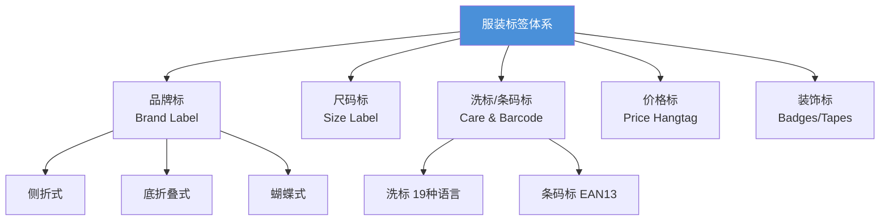

# 标签附着标准

LC Waikiki 为梭织（Woven）和针织（Jersey）产品分别制定了独立的标签附着标准：**ST 204**（梭织）和 **ST 206**（针织）。两类产品的标签附着方式有显著差异[^1][^2]。

---

## 标签类型总览



---

## 梭织面料（ST 204）vs 针织面料（ST 206）

| 对比项 | 梭织（ST 204） | 针织（ST 206） |
|-------|--------------|--------------|
| 品牌标位置 | 后背中缝两侧，距领缝2-3cm | 后背中缝两侧，领缝内/包缝内/领贴内 |
| 洗标位置 | 左侧缝，距下摆/腰头指定距离 | 左内侧缝 |
| 条码标位置 | 洗标上方 | 洗标上方 |
| 适用 | 衬衫、梭织裤、西装等 | T恤、Polo、针织裤等 |

---

## 品牌标（Brand Label）附着方法

### 方法1：侧折式品牌标（带独立尺码标）

适用于梭织和针织产品：

```
       ┌──────────────┐
       │   LC Waikiki │  ← 品牌标
       │   ────────   │
       │    Size: M   │  ← 尺码标（可侧放或底放）
       └──────────────┘
```

- 对称放置在 **后中两侧**
- 与领缝缝合在一起
- 距领缝距离：
  - 女装：**2 cm**
  - 男童：**2.5 cm**
  - 男装：**3 cm** [^1]

### 方法2：底折叠式品牌标

- 品牌标底部折叠
- 与领缝一起缝合

### 方法3：蝴蝶式品牌标

- 两侧缝份均与领缝缝合
- 尺码标放在品牌标旁边

### 裤子/裙子的品牌标

| 品类 | 位置 |
|------|------|
| 前开口裤子/裙子 | 内腰头 **后中** |
| 后开口裙子 | 内腰头 **前中** |
| 儿童连体衣 | 内侧后中，距上边缘 4cm |

---

## 洗标与条码标附着

### 梭织产品（ST 204）

| 品类 | 洗标/条码标位置 | 距下摆/腰头 |
|------|---------------|------------|
| 男童/女童裤 | 左侧缝，腰头下 | 4-5 cm（儿童）/7 cm（青年）/10 cm（成人） |
| 男装裤 | 腰头缝，距侧缝6cm向前 | — |
| 男童衬衫 1-4岁 | 内左侧缝 | 距下摆 7 cm |
| 男童衬衫 5-16岁 | 内左侧缝 | 距下摆 8 cm |
| 男装衬衫 | 内左侧缝 | 距下摆 10 cm |
| 可反穿夹克/大衣/背心 | 左内袋开口朝内 | — |

### 针织产品（ST 206）

| 品类 | 位置 |
|------|------|
| 上装 | 左内侧缝 |
| 连衣裙/裙子 | 左内侧缝 |
| 裤子（有侧缝） | 左内侧缝 |
| 裤子（无侧缝） | 后中内腰 |
| 内衣（男/女童） | **后外侧**（背部外面） |

---

## 价格标（Hangtag）与备扣

### 价格标位置

| 品类 | 位置 |
|------|------|
| 有纽扣款式 | 纽扣处 |
| 有按扣款式 | 按扣处 |
| 男装/男童衬衫 | 品牌标签处 |
| 带拉链款式 | 拉链头处 |

### 备扣

- 所有带纽扣的产品应附 **备扣**
- 备扣附在价格标或品牌标处

---

## 装饰标（Badges/Labels/Tapes）

| 缝制方式 | 说明 |
|---------|------|
| 四边缝合 | 上线颜色匹配标签，底线颜色匹配面料 |
| 两侧缝合（可折叠或不折叠） | 上线颜色匹配标签，底线颜色匹配面料 |
| 上下边缘缝合（可折叠或不折叠） | 上线颜色匹配标签，底线颜色匹配面料 |

---

## 信息一致性要求

- 产品价格标签、内部条码标签、Lot 标签和纸箱标签的 **信息必须一致**
- 系统中定义的尺码和颜色分布必须与实物一致
- 条码编码使用 **EAN13** 标准

---

## 参考

[^1]: ST 204 - Label Attachment Standards for Apparel Products Made of Woven Fabric.pdf, p.2-9
[^2]: ST 206 - Label Attachment Standards for Apparel Products Made of Jersey Fabric.pdf, p.2-10
