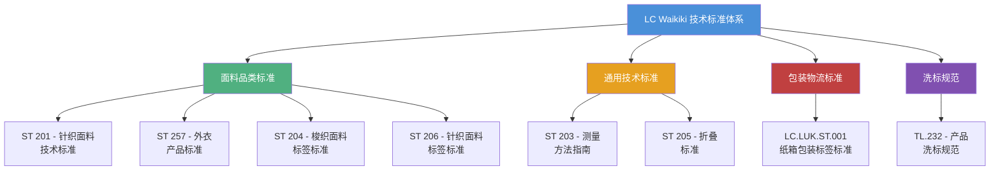

# LC Waikiki 品质标准体系

LC Waikiki 建立了一套完整的服装产品技术标准体系，覆盖从面料选择、生产工艺、标签附着、产品测量、折叠包装到物流运输的全链条。标准由 **Technical Directorate（技术总监部）** 制定和维护，所有供应商必须严格遵守。

---

## 标准体系架构

---

## 标准分类详述

### 按面料品类分

| 标准编号 | 名称 | 适用范围 | 修订版 |
|---------|------|---------|-------|
| ST 201 | 针织面料产品技术标准 | T恤、Polo衫、卫衣、针织裤等 | Rev.02 (2014) |
| ST 257 | 外衣产品标准 | 外套、夹克、大衣、棉服等 | Rev.00 (2019) |
| ST 204 | 梭织面料产品标签附着标准 | 衬衫、梭织裤、西装等 | Rev.00 (2010) |
| ST 206 | 针织面料产品标签附着标准 | 针织衫、T恤、针织裙等 | Rev.00 (2010) |

### 按功能分

| 标准编号 | 功能 | 关键内容 |
|---------|------|---------|
| ST 203 | 产品测量方法 | 统一编码系统、各品类测量位置图示 |
| ST 205 | 折叠方法 | 各品类标准折叠步骤 |
| LC.LUK.ST.001 | 纸箱包装与标签 | 纸箱规格、内盒包装、外箱标签、封箱胶带 |
| TL.232 | 产品洗标 | 19种语言、4种符号说明语言、尺寸规格 |

---

## 标准之间的关系

不同标准之间存在交叉引用。例如：

- 针织面料的 **标签附着** 遵循 ST 206，而标签 **内容** 则遵循 TL.232 规范
- 所有产品的 **洗标内容** 由 TL.232 定义，但洗标 **缝制位置** 由 ST 204/ST 206 规定
- 产品完成生产后，**折叠** 按 ST 205 执行，**装箱** 按 LC.LUK.ST.001 执行
- **测量** 方法 ST 203 适用于所有品类

---

## 标准的修订与版本控制

标准的首页标注 **修订编号（Rev. No）** 和 **日期**：

| 标准 | 最后修订 |
|------|---------|
| ST 201 | Rev.02, 2014年8月14日 |
| ST 203 | Rev.2, 2014年8月26日 |
| ST 257 | Rev.00, 2019年10月 |
| ST 204/205/206 | Rev.00, 2010年 |
| LC.LUK.ST.001 | Rev.1, 2021年6月1日 |

所有标准均声明："**All sorts of information in this document belongs to LC WAİKİKİ... and can be only used by possessor or with permission of possessors.**"[^1]

---

## 参考

[^1]: ST 204 - Label Attachment Standards for Apparel Products Made of Woven Fabric.pdf, p.1
[^2]: ST 201-02 - Technical Standards for Apparel Products Made of Jersey Fabric.pdf, p.1
[^3]: Outerwear Apparal Standards.pdf, p.3
[^4]: LC.LUK.ST.001_EN_1 CARTON BOX PACKAGING AND LABELLING STANDARD_.pdf, p.1
