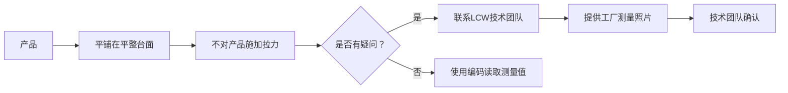

# 服装测量编码系统

LC Waikiki 使用一套统一的 **W-code 编码系统** 来标准化所有品类的服装测量。每个测量位置有唯一的代码，同一代码在不同品类中代表相同的测量位置[^1]。

---

## 编码系统结构

```mermaid
graph TD
    A[W-code 测量系统] --> B[W05 胸宽]
    A --> C[W06@ 前片宽度<br/>@cm 下方肩高点]
    A --> D[其他 W-codes]

    B --> E[衬衫 Chest Width]
    B --> F[夹克 Chest Width]
    B --> G[T恤 Chest Width]

    C --> H[输入值即确定<br/>测量位置]

    style A fill:#4a90d9,color:#fff
    style B fill:#50b080,color:#fff
    style C fill:#e6a020,color:#000
```

---

## 核心规则

| 规则 | 说明 |
|------|------|
| **统一编码** | 所有尺寸使用代码标识，例如 W05 = 胸宽 |
| **跨品类通用** | 同一代码在不同品类中表示相同测量位置，例如 W05 可用于衬衫、夹克、T恤等 |
| **变量组件 @** | 包含可变参数的代码，例如 W06@ = 肩高点下方 @ cm 处的前片宽度。传入具体数值后显示为"W06@ = 前片宽度，肩高点下方 11cm" |
| **点对点测量** | 测量描述和图示显示从一点到另一点的测量方式 |
| **校准量尺** | 必须从品牌认可的校准量尺厂商处购买量尺 |

---

## 测量操作规范

| 要求 | 说明 |
|------|------|
| 测量表面 | **平整表面**，不得覆盖布料 |
| 悬挂 | 测量时产品不得悬挂在测量台边缘 |
| 拉伸 | 不得拉扯、移动、拉伸或挤紧产品 |
| 单件 | 不得一次测量多件产品 |
| 技术支持 | 如有疑问，联系 LC Waikiki 技术团队（总部或本地办公室） |
| 可视化 | 如有疑问，向工厂提供测量方式的视觉图像 |



---

## 测量品类覆盖

| 品类 | 说明 |
|------|------|
| 衬衫 | Gömlek / Shirts |
| 裤子 | Pantolon / Pants |
| 下装细节 | Alt bölge detay / Bottom details |
| 裙子 | Etek / Skirts |
| 夹克 | Ceket / Jackets |
| 外衣 | Dış giyim / Outerwear |
| 连体衣 | Tulum / Overall |
| 针织衫 | Triko / Knit |
| 针织T恤/Polo/抓绒 | Örme tişört, polo ve polar |
| 背心 | Atlet / Tanks |
| 吊带背心 | Askılı ve kolsuz atlet / Cami and halter |
| 内裤/泳裤 | Külot ve yüzme alt / Panties and bottoms |
| 连体泳衣 | Mayo / Swimsuit |
| 比基尼 | Bikini / Bikini |

---

## 参考

[^1]: ST 203-03_Ölçüm Yerleri-How to Measure.pdf, p.1-4
