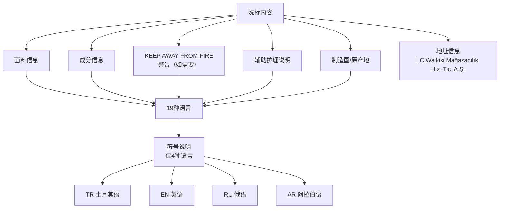

# 产品洗标规范

本标准规定了 LC Waikiki 产品洗标（Care Label）的标准格式、内容规则和缝制方法，由 **Buying and Merchandising Management（采购与商品管理）** 部门负责[^1]。

---

## 洗标内容结构

---

## 19种语言

洗标内容须以以下 19 种语言呈现（按固定顺序）：

| 序号 | 代码 | 语言 | 序号 | 代码 | 语言 |
|------|------|------|------|------|------|
| 1 | TR | 土耳其语 | 11 | CN | 中文 |
| 2 | EN | 英语 | 12 | FR | 法语 |
| 3 | RU | 俄语 | 13 | ID | 印尼语 |
| 4 | UA | 乌克兰语 | 14 | FA | 波斯语 |
| 5 | RO | 罗马尼亚语 | 15 | AL | 阿尔巴尼亚语 |
| 6 | BG | 保加利亚语 | 16 | BH | 波斯尼亚语 |
| 7 | PL | 波兰语 | 17 | SR | 塞尔维亚语 |
| 8 | KZ | 哈萨克语 | 18 | MS | 马来语 |
| 9 | AZ | 阿塞拜疆语 | 19 | MK | 马其顿语 |
| 10 | AR | 阿拉伯语 | | | |

---

## 标准洗标规格

### 尺寸

| 参数 | 数值 |
|------|------|
| 宽度 | **2.5 cm** |
| 长度（缝制前） | **11.2 cm** |
| 缝份 | 约 2.0 cm（右侧） |
| 长度（缝制后） | **9.2 cm** |

### 字体规格

| 内容 | 字体 | 字号 | 样式 | 颜色 |
|------|------|------|------|------|
| 国家代码 | Arial | 6pt | 加粗 | 黑色 |
| "KEEP AWAY FROM FIRE" | Arial | 6pt | 常规 | **红色** |
| 其他所有文字 | Arial | 5pt | 常规 | 黑色 |

### 版面要求

- 双面印刷（Duplex-printed）
- 页码仅位于正面的右下角
- 虚线仅位于第一页正面
- 每页开头留 **2.0 cm** 空白（缝份在右侧）
- 缝制空间（stitching space）包含：款号、订单号、特殊代码、产品名、品牌、颜色代码和颜色名称

---

## 洗标缝制要求

- 洗标以连续页方式叠放在一起缝制在服装上
- **不得以环状（loop）方式缝制**（特殊 KPN 标签除外）
- 缝制后标签长度为 **9.2 cm**

---

## 洗标类型

### 1. 标准洗标（Standard Product Care Label）

- 符号说明以 4 种语言（TR/EN/RU/AR）书写
- 所有其他信息以 19 种语言呈现

### 2. 折叠缎面洗标（Folded Satin Label）

| 参数 | 数值 |
|------|------|
| 尺寸 | 35 × 66 mm |
| 缝份间隙 | 13 mm |
| 符号说明 | **不写任何语言的符号说明** |
| 页码 | 位于缝制空间 |

### 3. 小产品洗标（Care Label for Small Product）

适用于尺寸较小的产品（见附录-2）

### 4. 婴儿组洗标（Baby Group Care Labels）

适用于婴儿产品（见附录-3）

---

## 其他专用标签

| 附录 | 标签类型 | 用途 |
|------|---------|------|
| Appendix-4 | 内部条码标签 | 产品内部条码 |
| Appendix-5 | 牛仔布警告标签 | 牛仔产品 |
| Appendix-6 | 冲洗警告标签 | 需特别冲洗说明 |
| Appendix-7 | 扎染/渐变色警告标签 | 扎染、段染等特殊工艺产品 |

---

## 制作工具

洗标使用 **Tema Tekstil-Etiket/Ürün Karışım（Tema 纺织标签/服装成分）** 程序制作，生成 PDF 格式后发送给供应商[^1]。

---

## 参考

[^1]: Preparation and Contents of Product Care Labels.pdf, p.1-10
