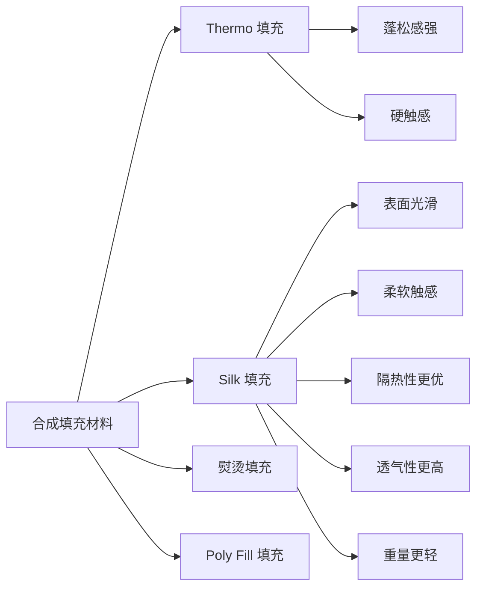

## 概述

合成填充材料是外衣（Outerwear）生产中用于保暖的关键辅料，原材料主要为聚酯（Polyester）。相比天然填充物，合成填充材料成本更低、可批量生产，广泛应用于服装行业。LC Waikiki 的 ST 257 标准对这些材料进行了详细分类和规范。[^1]

## 填充材料分类

LC Waikiki 将合成填充材料分为以下主要类别：

| 类型 | 内部名称 | 特征 | 手感 | 主要用途 |
|------|---------|------|------|---------|
| **Thermo 填充** | THERMO | 蓬松、体积大、经热处理获得 | 硬触感，毛刷状末端 | 需蓬松感的款式 |
| **Silk 填充** | SILK | 表面熨烫、分层光滑、导管结构含空气 | 柔软 | 需更好隔热和透气性 |
| **熨烫填充** | — | 上下覆盖里布 | 柔软 | 全表面绗缝款式 |
| **Poly Fill 填充** | — | 空气间隙结构，接近鹅绒隔热性 | 蓬松柔软 | 替代天然羽绒 |

## 纤维类型对比

| 纤维类型 | 手感 | 特点 |
|---------|------|------|
| **7D** | 硬结构 | 基础型填充纤维 |
| **0.7D** | 比 7D 柔软 | 较重纤维类型 |
| **0.8D** | 柔软轻便 | 最接近鹅绒的外观和触感 |
| **0.9D** | 比 0.8D 硬 | 更蓬松的外观 |
| **Sorona** | 柔软轻便 | 使用玉米纤维为原料 |

> ⚠️ **禁令**：**珠状纤维（Bead fibers）禁止使用**，因洗涤后变形、使用中纤维局部积聚、难以实现均匀外观。

## Thermo 与 Silk 对比

## 填充方法

| 方法 | 状态 | 说明 |
|------|------|------|
| 手工或气压填充 | ❌ **禁止** | 洗涤后纤维局部积聚，变形严重 |
| 手工铺放法 | ✅ **推荐** | 三层（面料+填充+里布）一起缝合，无局部积聚问题 |
| 可水洗填充法 | ✅ 替代方案 | 适用于无法实施铺放法的工厂 |

### 实施注意事项

- 纤维与面料之间根据需要增加衬料或里布，防止纤维外漏
- 缝纫针必须使用 **圆头针**
- 线径需足以填充针孔间隙，防止纤维从针孔逃逸
- 检查模型是否有足够的剪口和接缝以确保填充材料均匀附着

[^1]: Outerwear Apparal Standards.pdf