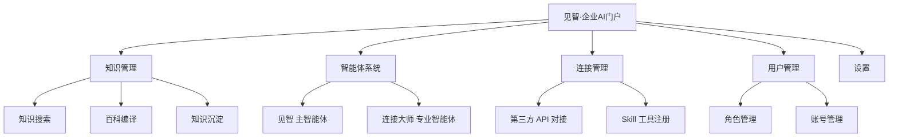

## 概述

**见智（Jianzhi）** 是一个企业级 AI 门户系统，提供智能问答、知识管理、第三方系统连接等功能。作为企业 AI 助手，"见智"主智能体负责回答企业知识相关问题、遵循企业沟通规范、执行业务操作等。[^1]

## 核心功能

| 功能 | 说明 |
|------|------|
| **智能问答** | 基于企业知识库回答各类问题 |
| **知识管理** | 知识库维护、百科编译、知识沉淀 |
| **智能体系统** | 主智能体（见智）+ 专业智能体（如连接大师） |
| **系统连接** | 通过 Skill 工具对接第三方系统 |
| **用户管理** | 角色管理、账号管理、权限控制 |
| **附件处理** | 支持 PDF、Excel、CSV 等格式解析 |

## 系统架构

## 可切换智能体

| 智能体 | ID | 功能 |
|-------|-----|------|
| **见智** | — | 主智能体，企业AI助手 |
| **连接大师** | connector_master | 专用于创建第三方系统连接 |

## 可用功能面板

| 面板名称 | ID | 用途 |
|---------|-----|------|
| 知识库 | kb | 知识文档管理 |
| CoWorker管理 | cw | 协作者管理 |
| 价值看板/统计 | dash | 数据统计与看板 |
| 连接管理 | skills | 第三方系统连接配置 |
| 智能体管理 | agents | 智能体配置管理 |
| 用户管理 | users | 账号与角色管理 |
| 设置 | cfg | 系统设置 |

[^1]: 用户手册.md