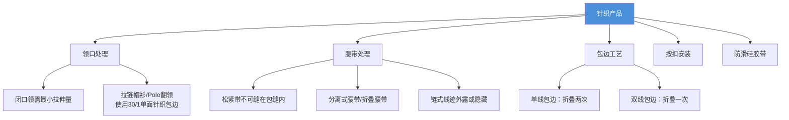

# ST 201 - 针织面料产品技术标准

**修订版**：Rev.02，2014年8月14日  
**发布部门**：Technical Directorate（技术总监部）[^1]

---

## 概述

ST 201 规定了针织面料（Jersey Fabric）服装产品的技术标准，适用于婴儿装、童装和成人装。内容包括工作方法、缝制工艺、粘合衬要求和针织面料专用缝纫标准。

---

## 关键工艺要求

---

## 详细技术要求

### 1. 领口拉伸（Neck Stretching）

| 品类 | 要求 |
|------|------|
| 婴儿装 | 领口需有最小拉伸量 |
| 童装 | 领口需有最小拉伸量 |
| 成人装 | 领口需有最小拉伸量 |

- 闭口领/立领仅使用内后领包边即可
- 闭口领和连帽产品可根据设计偏好不使用领包边

### 2. 松紧腰带工艺

**核心原则**：松紧带 **不得** 缝在腰带缝（包缝线）内，否则包缝机刀片可能切断松紧带。

| 方法 | 描述 | 外观 |
|------|------|------|
| a) 链式线迹腰带 | 缝线从外部可见 | 外露线迹 |
| b) 罗纹腰带四边固定 | 松紧带固定在罗纹腰带内侧四边，折叠后缝合到衣身 | 外部无线迹 |
| c) 水平覆盖缝 | 松紧带在内部水平覆盖缝固定 | 外部不可见 |

### 3. 弹性下摆产品

针织裤、慢跑裤、百慕大短裤等弹性下摆产品，可在前中做装饰性门襟。

### 4. 后口袋

如无其他要求，针织裤、短裤和七分裤的 **右侧** 应设有后口袋。

### 5. 拉链帽衫/Polo翻领包边

整条领缝需用 **30/1 单面针织包边或人字带** 覆盖。

### 6. 按扣安装

| 包边宽度 | 按扣位置 |
|---------|---------|
| ≤1.0 cm | 按扣安装在包边旁，不得在包边上 |
| ≥1.1 cm | 按扣居中安装在包边上 |

### 7. 包边工艺

| 线迹类型 | 包边带折叠方式 |
|---------|--------------|
| 单线 | 折叠两次 |
| 双线 | 折叠一次 |

### 8. 防滑硅胶带

在易松脱的风险区域（女装/女童的袖窿、肩带、后背领口、肩缝等）应使用硅胶带，注意调整线张力。

### 9. 无绳镶边

宽度应为 **0.3 cm**，除非另有要求，使用 **30/1 单面针织**。

---

## 相关实体

| 实体 | 关系 |
|------|------|
| [[st-206|ST 206 - 针织面料标签标准]] | 同一面料品类的标签附着标准 |
| [[lc-waikiki|LC Waikiki]] | 品牌所有者 |
| [[concepts/label-attachment|标签附着标准]] | 标签附着方法 |

---

## 参考

[^1]: ST 201-02 - Technical Standards for Apparel Products Made of Jersey Fabric.pdf, p.1-10
