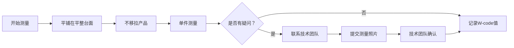

# ST 203 - 测量方法指南

**修订版**：Rev.2，2014年8月26日  
**发布部门**：Teknik Direktörlük / Technical Directorate（技术总监部）[^1]

---

## 概述

ST 203 是 LC Waikiki 的产品测量方法指南，包含所有品类的基本测量方法及其描述。使用 **W-code 编码系统** 统一管理所有测量位置。

---

## 测量品类覆盖

| # | 品类 | 中文 | 英文 |
|---|------|------|------|
| 1 | Gömlek | 衬衫 | Shirts |
| 2 | Pantolon | 裤子 | Pants |
| 3 | Alt bölge detay | 下装细节 | Bottom details |
| 4 | Etek | 裙子 | Skirts |
| 5 | Ceket | 夹克 | Jackets |
| 6 | Dış giyim | 外衣 | Outerwear |
| 7 | Tulum | 连体衣 | Overall |
| 8 | Triko | 针织衫 | Knit |
| 9 | Örme tişört, polo ve polar | 针织T恤/Polo/抓绒 | Knittees, polos & fleece |
| 10 | Atlet | 背心 | Tanks |
| 11 | Askılı ve kolsuz atlet | 吊带背心 | Basic cami and halter |
| 12 | Külot ve yüzme alt | 内裤/泳裤 | Panties and bottoms |
| 13 | Mayo | 连体泳衣 | Swimsuit |
| 14 | Bikini | 比基尼 | Bikini |

---

## W-code 编码示例

| 编码 | 含义 | 适用品类 |
|------|------|---------|
| W05 | 胸宽（Chest Width） | 衬衫、夹克、T恤、外套等 |
| W06@ | 肩高点下方@cm处的前片宽度（Across Front） | 含变量参数 |

---

## 测量规则

> 详见 [[concepts/measurement-code-system|服装测量编码系统]] 概念页面。

---

## 相关实体

| 实体 | 关系 |
|------|------|
| [[lc-waikiki|LC Waikiki]] | 品牌所有者 |
| [[concepts/measurement-code-system|服装测量编码系统]] | 编码系统的详细说明 |

---

## 参考

[^1]: ST 203-03_Ölçüm Yerleri-How to Measure.pdf, p.1-4
