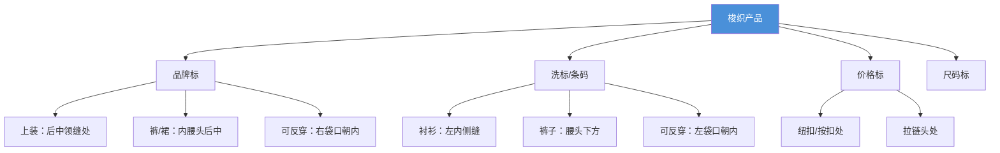

# ST 204 - 梭织面料标签附着标准

**修订版**：Rev.00，2010年  
**发布部门**：TEMA Mağazacılık Hiz. Tic. A.Ş.（LC Waikiki 前身）[^1]

---

## 概述

ST 204 规定了梭织面料（Woven Fabric）服装产品上各类标签的附着位置和方法。适用于衬衫、梭织裤、夹克、大衣、裙子等梭织产品。

---

## 关键标签位置一览

---

## 品牌标附着方法

| 方法 | 图示 | 适用 |
|------|------|------|
| 侧折式 + 独立尺码标 | 品牌标两侧对称于后中 | 上装 |
| 底折叠式 + 独立尺码标 | 品牌标底部折叠，与领缝缝合 | 上装 |
| 蝴蝶式 + 独立尺码标 | 两侧缝份均与领缝缝合 | 上装 |

### 距领缝距离

| 品类 | 距离 |
|------|------|
| 女装 | 2 cm 下方 |
| 男童 | 2.5 cm 下方 |
| 男装 | 3 cm 下方 |

### 下装品牌标

| 品类 | 位置 |
|------|------|
| 前开口裤子/裙子 | 内腰头后中 |
| 后开口裙子 | 内腰头前中 |
| 儿童连体衣 | 内侧后中，距上边缘4cm |

---

## 洗标与条码标

### 上装

| 品类 | 位置 | 距下摆 |
|------|------|-------|
| 男女衬衫/女装上衣 | 内左侧缝 | 10 cm |
| 男童衬衫 1-4岁 | 内左侧缝 | 7 cm |
| 男童衬衫 5-16岁 | 内左侧缝 | 8 cm |
| 可反穿夹克/大衣/背心 | 左内袋开口朝内 | — |

### 下装

| 品类 | 位置 |
|------|------|
| 男女童裤 | 左侧缝，腰头下方 |
| 男装裤 | 腰头缝，距侧缝6cm向前 |
| 童裤 | 距腰头 4-5 cm |
| 青年裤 | 距腰头 7 cm |
| 成人裤 | 距腰头 10 cm |

---

## 相关实体

| 实体 | 关系 |
|------|------|
| [[st-206|ST 206 - 针织面料标签标准]] | 同类标准的针织版本 |
| [[lc-waikiki|LC Waikiki]] | 品牌所有者 |
| [[concepts/label-attachment|标签附着标准]] | 标签附着方法综述 |

---

## 参考

[^1]: ST 204 - Label Attachment Standards for Apparel Products Made of Woven Fabric.pdf, p.1-10
