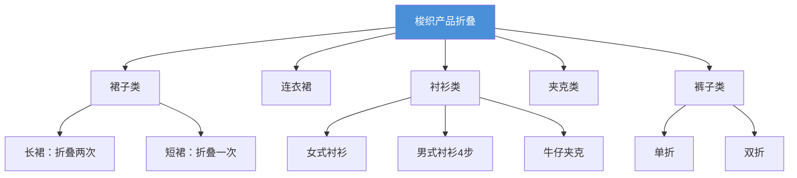

# ST 205 - 梭织产品折叠标准

**修订版**：Rev.00，2010年  
**发布部门**：TEMA Mağazacılık Hiz. Tic. A.Ş.[^1]

---

## 概述

ST 205 规定了梭织面料产品的标准折叠方法。每个品类都有指定的折叠步骤，分为 **悬挂（Hung）** 和 **平放（Flat）** 两种初始状态。

---

## 各品类折叠方法



---

## 折叠标准汇总表

| 品类 | 初始状态 | 折叠次数 | 步骤数 |
|------|---------|---------|-------|
| 长裙（Maxi Skirt） | 悬挂 | 2次 | 2步 |
| 短裙（Miniskirt） | 悬挂 | 1次 | 2步 |
| 连衣裙（Dress） | 悬挂 | 2次 | 2步 |
| 女式衬衫（Ladies' Shirt） | — | — | 2步 |
| 牛仔夹克（Jean Jacket） | 悬挂 | 1次 | 2步 |
| 男式衬衫（Shirt） | 平放 | — | **4步** |
| 外套/粗呢大衣（Duffle Coat） | 悬挂 | 1次或2次 | 2步 |
| 夹克（Jacket） | 悬挂 | 1次 | 2步 |
| 裤子（Pants） | 平放 | 单折/双折 | 2步 |

---

## 典型折叠示例

### 男式衬衫（4步折叠）

```
步骤1          步骤2          步骤3          步骤4
┌────┐        ┌────┐        ┌────┐        ┌────┐
│ 肩 │        │ 折 │        │ 折 │        │ 整 │
│ 膀 │   →    │ 叠 │   →    │ 叠 │   →    │ 理 │
│ 后 │        │ 袖 │        │ 衣 │        │ 成 │
│ 翻 │        │ 子 │        │ 身 │        │ 型 │
└────┘        └────┘        └────┘        └────┘
```

### 裤子折叠

| 方式 | 步骤 |
|------|------|
| 单折 | 折叠一次腰部至下摆 |
| 双折 | 折叠两次腰部至下摆 |

---

## 相关实体

| 实体 | 关系 |
|------|------|
| [[lc-luk-st-001|LC.LUK.ST.001 - 纸箱包装标签标准]] | 折叠后装入纸箱的包装标准 |
| [[lc-waikiki|LC Waikiki]] | 品牌所有者 |
| [[concepts/carton-box-packaging|纸箱包装标准]] | 包装规范 |

---

## 参考

[^1]: ST 205 - Folding Standards for Apparel Products Made of Woven Fabric.pdf, p.1-5
