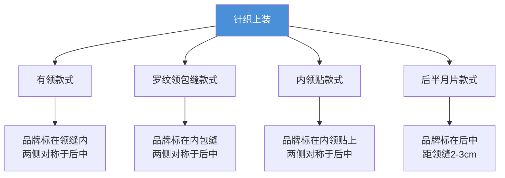

# ST 206 - 针织面料标签附着标准

**修订版**：Rev.00，2010年  
**发布部门**：TEMA Mağazacılık Hiz. Tic. A.Ş.[^1]

---

## 概述

ST 206 规定了针织面料（Jersey Fabric）服装产品上各类标签的附着位置和方法。适用于 T恤、Polo 衫、针织衫、针织裤、内衣等产品。

---

## 不同领型/款式的品牌标附着

---

## 品牌标附着方法

针织产品支持三种品牌标形式：

| 方法 | 描述 |
|------|------|
| **侧折式** | 品牌标两侧折叠，尺码标可放在侧边或底部 |
| **蝴蝶式** | 品牌标两侧缝份与缝线一同缝合，尺码标在旁边 |
| **底折叠式** | 品牌标底部折叠，缝份与缝线一同缝合 |

### 各类款式的附着方式

| 款式类型 | 品牌标位置 | 缝制方式 |
|---------|-----------|---------|
| **有领款式** | 后中两侧 - 内领缝 | 两条水平线，线色匹配衣身 |
| **罗纹领包缝** | 后中两侧 - 内包缝 | 两条水平线，线色匹配衣身 |
| **内领贴** | 后中两侧 - 内领贴 | 两条水平线，线色匹配领贴 |
| **后半月片** | 后中两侧 - 距领缝2-3cm | 两侧缝合，线色匹配衣身 |
| **裤子** | 后中两侧 - 内包缝 | 两条水平线，线色匹配衣身 |

---

## 洗标与条码标

- **条码标**：每个颜色和每个尺码应有不同的条码标签
- **条码位置**：始终放在洗标**上方**

| 品类 | 洗标位置 |
|------|---------|
| 上装 | 左内侧缝 |
| 连衣裙/裙子 | 左内侧缝 |
| 裤子（有侧缝） | 左内侧缝 |
| 裤子（无侧缝） | 后中内腰 |
| 内衣 - 男/男童 | 后外侧（背部外面） |
| 内衣 - 女/女童 | 后外侧（背部外面） |

---

## 装饰标（Badges/Labels/Tapes）

| 缝制方式 | 线色规则 |
|---------|---------|
| 四边缝合 | 上线匹配标签，底线匹配面料 |
| 两侧缝合（可折叠） | 上线匹配标签，底线匹配面料 |
| 上下边缘缝合（可折叠） | 上线匹配标签，底线匹配面料 |

### 旗标（Folded Flag Label）

折叠线在标签中间，缝份根据标签位置确定缝制方式。

---

## 相关实体

| 实体 | 关系 |
|------|------|
| [[st-201|ST 201 - 针织面料技术标准]] | 同一品类生产工艺标准 |
| [[st-204|ST 204 - 梭织面料标签标准]] | 同类标准的梭织版本 |
| [[lc-waikiki|LC Waikiki]] | 品牌所有者 |
| [[concepts/label-attachment|标签附着标准]] | 标签附着方法综述 |

---

## 参考

[^1]: ST 206 - Label Attachment Standards for Apparel Products Made of Jersey Fabric.pdf, p.1-12
