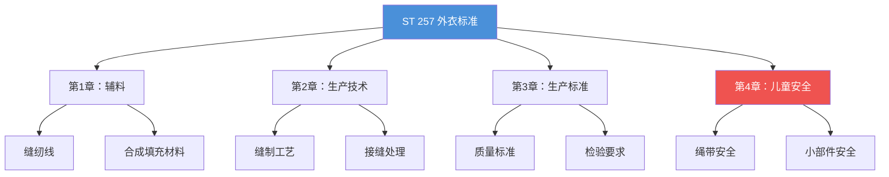

# ST 257 - 外衣产品标准

**修订版**：Rev.00，2019年10月  
**发布部门**：Garment Technology Management / Garment Technology and Social Compliance Directorate（服装技术管理 / 服装技术与社会合规总监部）[^1]

---

## 概述

ST 257 是 LC Waikiki 外衣产品的核心技术标准，定义了外衣生产中必须应用的技术标准及应用方法。本标准由采购部门（Sourcing）提供给合作生产商，仅 LC Waikiki 有权修订[^1]。

---

## 标准结构

---

## 第1章：辅料

### 缝纫线

- 使用经过测试认证的 nominated 聚酯/包芯线
- 线品质信息需添加到 **技术数据表（Technical Data Sheet）** 中
- 接缝最小缝份 **1.2 cm**
- 每厘米 **至少4个针迹**[^1]

### 合成填充材料

详见 [[concepts/synthetic-filling-materials|合成填充材料分类]] 概念页面。

四大类型：
1. **Thermo Padding（热压填充）** — 蓬松、硬触感
2. **Silk Padding（丝质填充）** — 柔软、层状、高透气
3. **Ironed Padding（熨烫填充）** — 上下覆内衬，适合绗缝
4. **Poly Fill Padding（聚酯填充）** — 最接近羽绒，湿态保暖

> ⚠️ **珠状纤维（Bead fibers）禁止使用**

---

## 第2-3章：生产技术与标准

涵盖外衣产品的：
- 缝制工艺要求
- 接缝处理方法
- 质量标准
- 检验要求

---

## 第4章：儿童安全实施

详见 [[concepts/children-safety|儿童安全规范]] 概念页面。

包括：
- 绳带安全：头颈部不得有自由端绳带
- 小部件安全：按扣/纽扣需通过拉力测试
- 包装安全：Polybag 安全警告
- 洗标警示："KEEP AWAY FROM FIRE"

---

## 相关实体

| 实体 | 关系 |
|------|------|
| [[lc-waikiki|LC Waikiki]] | 品牌所有者 |
| [[concepts/synthetic-filling-materials|合成填充材料分类]] | 外衣关键辅料 |
| [[concepts/children-safety|儿童安全规范]] | 外衣儿童安全要求 |
| [[st-201|ST 201 - 针织面料技术标准]] | 并列标准 |

---

## 参考

[^1]: Outerwear Apparal Standards.pdf, p.3-10
