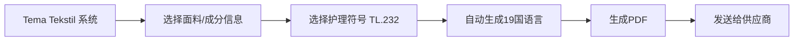

## 概述

**Tema Tekstil**（全称：Tema Tekstil-Etiket/Ürün Karışım，即"纺织标签/服装成分"程序）是 LC Waikiki 指定的产品护理标签制作系统。所有 LC Waikiki 产品的护理标签必须使用该系统以 PDF 格式生成并发送给供应商。[^1]

## 功能与用途

Tema Tekstil 程序用于：
1. 生成标准化的产品护理标签
2. 管理多语言内容（19种语言）
3. 集成 LC Waikiki 公司地址信息
4. 确保标签格式和内容的一致性

## 标签生成流程

## 关键规范

| 项目 | 内容 |
|------|------|
| 使用标准 | TL.232 - Product Care Labels |
| 输出格式 | PDF |
| 面料理料信息 | 先面料后成分（主面料、里料） |
| 地址信息 | 系统内置 LC Waikiki 公司地址 |
| 供应商沟通 | PDF 由品牌方生成后发送给供应商 |

## 相关文档

- 产品护理标签内容与制作标准（Preparation and Contents of Product Care Labels）
- TL.232 - Product Care Labels（护理符号标准）

[^1]: Preparation and Contents of Product Care Labels.pdf