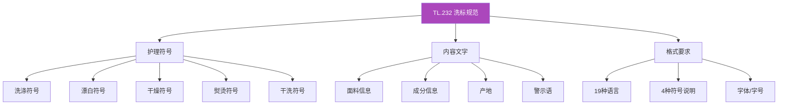

# TL.232 - 产品洗标规范

**所属部门**：Buying and Merchandising Management（采购与商品管理）

---

## 概述

TL.232 是 LC Waikiki 产品洗标（Product Care Labels）的符号和内容规范标准，与洗标制作程序 **Tema Tekstil-Etiket/Ürün Karışım** 配合使用。洗标的内容规则完全引用自 TL.232[^1]。

---

## 洗标内容体系

---

## 在洗标制作中的应用

TL.232 被 [[concepts/product-care-labels|产品洗标规范]] 和标准洗标制作流程直接引用：

| 引用项 | 规则来源 |
|-------|---------|
| 洗涤符号 | TL.232 - Product Care Labels |
| 符号说明文字 | TL.232 - Product Care Labels |
| 面料信息顺序 | TL.232 - Product Care Labels |
| 警示语格式 | TL.232 - Product Care Labels |

---

## 相关实体

| 实体 | 关系 |
|------|------|
| [[concepts/product-care-labels|产品洗标规范]] | 洗标制作的完整流程规范 |
| [[lc-waikiki|LC Waikiki]] | 品牌所有者 |

---

## 参考

[^1]: Preparation and Contents of Product Care Labels.pdf, p.1-8
